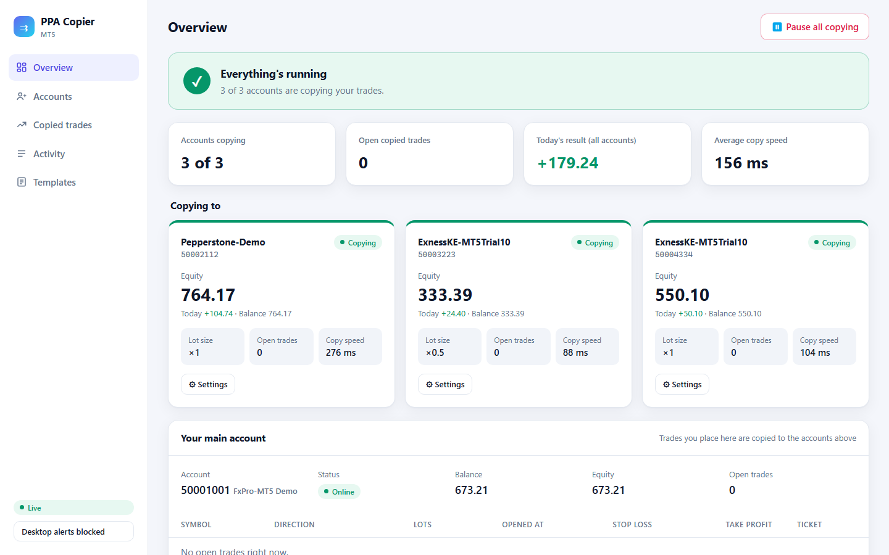
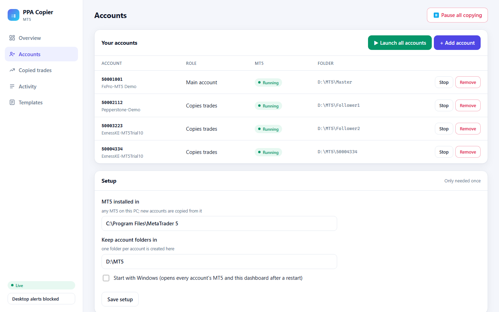
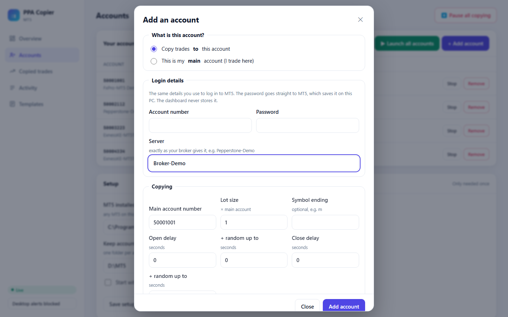
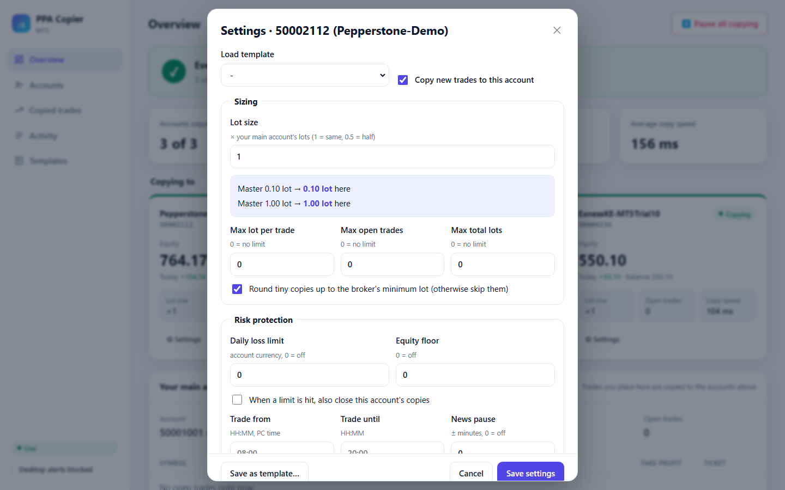
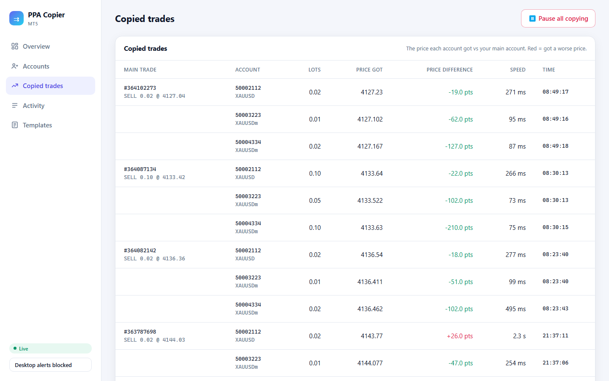
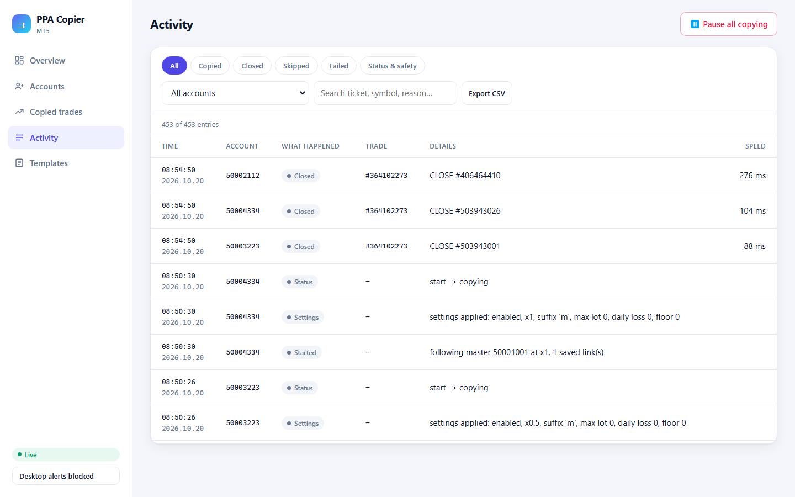

# MT5 PPA Copier

**Prop & Personal Account copier for MetaTrader 5.** A local trade copier for MT5. Place a trade once on your main account and it is copied, at the size you choose, to every other account you trade: prop firm accounts, personal broker accounts, or a mix of both. Everything runs on your own PC or VPS.

> **Status:** Works with MetaTrader 5 (MT5 only). Tested on demo accounts at FxPro, Pepperstone and Exness. See [plan.md](plan.md) for the design and roadmap.

---

## Why

Trading several accounts by hand means repeating every entry, stop change and exit in each terminal. It's slow, and one missed exit or wrong lot size can break a prop firm's drawdown rule.

Hosted copy-trading services solve the repetition, but:
- **Shared IPs:** orders come from their servers, whose IPs are shared with many unrelated users. A firm's checks may link your accounts to other people's trading.
- **Your passwords live on their servers.**
- **You pay monthly** and depend on their uptime.

**PPA Copier keeps everything on your machine:**
- **One fixed IP,** which only you use.
- **Passwords stay inside MT5** on your PC. The copier never stores them.
- **No server and no database:** terminals exchange small local files.
- **Fast:** a follower sees the master's trade within milliseconds. The rest of the time is the broker's own execution.

## Features

**Copying**
- Copies opens, closes, partial closes, and stop-loss / take-profit changes.
- **Self-correcting:** followers keep matching the master's open positions, so restarts, disconnects or missed updates never cause duplicate or missing trades.
- **Lot size per account** (e.g. ×1, ×0.5), with automatic scaling when brokers define a lot differently (contract size).
- **Symbol mapping** across brokers:
  - suffixes are detected automatically (`EURUSD` → `EURUSDm`)
  - built-in aliases cover names that differ completely (`GOLD` ↔ `XAUUSD`, `US30` ↔ `DJ30`, …)
  - your own mappings can be added too
- **Close-all is fast:** closes are sent to the broker together, not one after another.
- **Safe failure behaviour:**
  - If the master goes offline, followers keep their trades open.
  - Trades that can't be copied (not enough margin, market closed) are skipped with a clear reason, not retried pointlessly.

**Safety limits** (per account)
- Daily loss limit and equity floor, with an option to close all copies when hit.
- Max lot per trade, max open trades, max total lots.
- Trading hours and a pause around high-impact news (MT5 economic calendar).
- **Copy delay:** fixed plus a random extra, so accounts don't act in perfect sync.

**Dashboard** (local web page)
- **Overview:** a plain-language health banner ("Everything's running" / "Needs attention"), plus each account's equity, today's result, open trades and copy speed.
- **Accounts:**
  - **Add account** with one form: login, password, server, lot size. The dashboard creates the MT5, installs the copier, logs in and starts it.
  - **Launch all**, Start / Stop / Remove for each account, and **Start with Windows**.
- **Settings for each account,** applied within a second with no restart. Includes a live preview ("Master 0.20 lot → 0.10 lot here").
- **Copied trades:** the price each account got against the master's price.
- **Activity log:** filters (copied / closed / skipped / failed), search and CSV export.
- **Templates** for reusing settings, **Pause all copying**, and desktop or in-page alerts.

## Screenshots

**Overview:** one glance tells you whether everything is copying, with a card for each account.



**Accounts:** add an account with one form, then launch, stop or remove it.

| Your accounts | Add an account |
|---|---|
|  |  |

**Settings for each account:** lot size with a live preview, safety limits, copy delays and symbol mapping.



**Copied trades and activity:** the price each account got against the main account, and a searchable log of every copy, skip and error.

| Copied trades | Activity |
|---|---|
|  |  |

<sub>Account numbers in the screenshots are sample numbers. To refresh them: `cd dashboard\e2e` then `npm run screenshots`.</sub>

## Quick start

You need: **Windows**, **MT5** installed once (from any broker), and **Go 1.22+**.

```powershell
git clone https://github.com/MaweuPaul/trade-copier.git
cd trade-copier\dashboard
$env:GOARCH = "amd64"; go build -o tradecopier-dashboard.exe .
.\tradecopier-dashboard.exe          # opens http://127.0.0.1:8750
```

Then in the dashboard:
1. **Accounts → Setup:** check the MT5 install folder and where account folders go, then save.
2. **+ Add account:** add your **main** account first, then each account to copy to.
3. Open a small trade on the main account and watch it appear on every account.

Full guide, manual setup and troubleshooting: [docs/setup.md](docs/setup.md).

## How it works

```
 Main account's MT5                 Shared local folder               Each follower's MT5
 ┌──────────────────┐   writes     ┌─────────────────────┐   reads    ┌──────────────────────┐
 │ CopierMaster EA  │ ───────────▶ │ open positions      │ ◀───────── │ CopierFollower EA    │
 │ (your trades)    │  on change   │ (JSON)              │  every ms  │ opens/closes/adjusts │
 └──────────────────┘              └─────────────────────┘            │ to match             │
                                       ▲          ▲                   └──────────────────────┘
                                status │          │ settings, pause
                                       └── Dashboard (Go, 127.0.0.1) ──┘
```

1. The **master EA** writes its open positions the moment anything changes, plus a heartbeat every second.
2. Each **follower EA** checks about every millisecond. It compares the master's positions with its own copies and fixes any difference, at the master's lots × its own lot size.
3. The **dashboard** only reads status and writes settings. **Copying never goes through it**, so trades keep copying while it's closed.

File formats: [docs/snapshot-format.md](docs/snapshot-format.md).

## Tech stack

| Part | Technology |
|---|---|
| Copier | MQL5 Expert Advisors |
| Dashboard backend | Go, standard library only, a single `.exe` |
| Dashboard frontend | HTML, CSS, vanilla JavaScript modules (no framework, no build step) |
| Storage | Local JSON files, no database |
| Tests | Playwright end-to-end tests (`dashboard/e2e`) |

## Project layout

```
MQL5/Experts/TradeCopier/     CopierMaster.mq5, CopierFollower.mq5
MQL5/Include/TradeCopier/     shared EA modules: settings, risk, lots, symbols, links, event log
dashboard/                    Go server; web/ is the UI (embedded in the .exe)
dashboard/internal/           api, store (shared files), terminals (create/start/stop MT5), jsonfile
dashboard/e2e/                Playwright tests
scripts/deploy.ps1            compile the EAs into every account's MT5 after code changes
docs/                         setup guide and file formats
```

## Use cases

- **Prop firm traders:** run several evaluation or funded accounts from one set of trades, each with its own size and loss limits.
- **Multi-broker traders:** spread capital across brokers while trading one strategy.
- **Different risk levels:** mirror one strategy onto accounts with different lot sizes.

## Compliance

PPA Copier is meant for copying between **accounts you own**. Managing trades on other people's accounts may require regulatory authorization where you live.

Broker and prop firm rules differ and change over time. Before using any copier, check each firm's terms on:
- copy trading and trade copiers,
- copying between accounts owned by different people,
- hedging in opposite directions across accounts,
- high-frequency or latency-based trading.

Set each account's daily loss limit slightly below its firm's limit. You are responsible for following the rules of every firm you trade with.

## Disclaimer

Trading leveraged products carries a high level of risk. This software is provided "as is", with no warranty. The authors accept no liability for trading losses, account breaches or missed trades caused by using it. Test thoroughly on demo accounts before using it on live or funded accounts.
